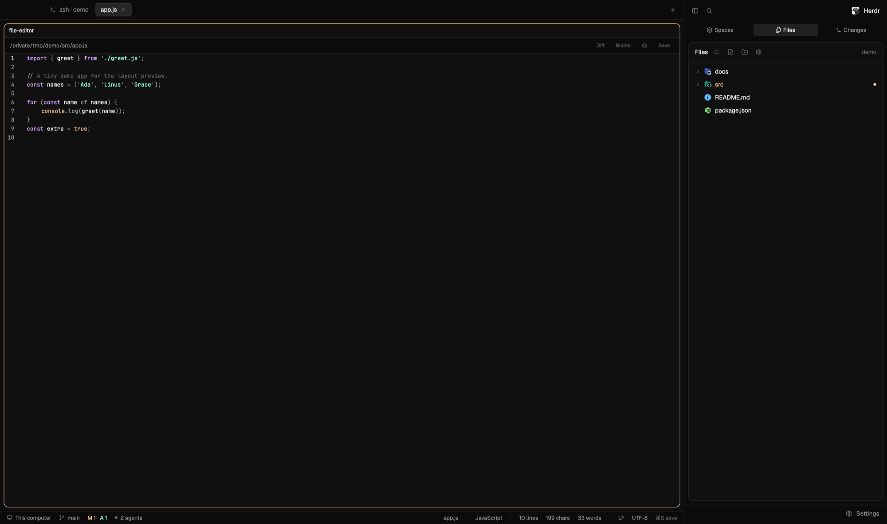

# Irfnd Layout

A one-window IDE on top of Herdr. A dark window with no system title bar: a tab strip on top, a
big work area of framed panes, a slim status bar at the bottom, and a 268 px sidebar on the right
that switches between Spaces (with the agents list), Files and Changes. A file opened from Files
or Changes opens full-size in its own editor tab, with Diff, Blame, save, and recovery of unsaved
text.



## What you see

The window is a row: the **work column** on the left (everything else), a **sidebar** 268 px wide
on the right, a 1 px `border` divider between them. The system title bar is hidden and the macOS
window buttons sit at (12, 12), so the tab strip leaves them room. Behind everything is `canvas`;
the sidebar is `chrome`. Terminal padding is 14 px vertical, 12 px horizontal.

**Work column**, top to bottom:
1. **Tab strip**, 42 px. Dragging it moves the window. One pill per tab of the shown space: the
   program's icon, the title, and an ✕ on the active pill. A terminal pill reads
   `<program> • <last command>`. A `+` on the right opens the new-tab menu (a terminal, installed
   agents, New space, New/Open worktree, Open with Zed). A tab with unsaved text is titled `● name`.
2. **Work area**, padding 8 px: the active tab's panes. Each pane is a card: radius 10, 1 px
   `border` outline, `background` fill, 8 px between cards, `accent` outline when focused; a lone
   pane is framed too. Each card has a 30 px header, always shown: program icon, agent name or
   terminal title, folder, agent status, buttons for split, zoom and close.
3. **Status bar**, 28 px. Left: the machine ("This computer"), the branch with ahead/behind arrows
   and change counts (`M 1`, `A 1`, ...), and "N agents". Right: with an editor tab shown, the file
   name, language, lines/chars/words, line ending, encoding and the save key; otherwise the
   command-palette hint.

**Sidebar**, top to bottom: a 46 px brand row (fold button and search on the left, the Herdr logo
on the right; dragging it moves the window); a 36 px switcher with three pills, Spaces, Files,
Changes; the body (one of three views); a 41 px footer with a Settings button.
- **Spaces view**, two halves. Top, the spaces list: a coloured letter avatar per space (or a
  picked image), the name, and where unusual the repo, branch and ahead/behind; worktrees nested
  under their checkout; user-made groups that fold; machine headers when more than one machine
  exists. Bottom, the agents list grouped by state (Working, Blocked, Done, Idle) with the agent's
  icon, title and how long ago it changed.
- **Files view**: the focused space's folder as a lazy tree with Charmed file icons. Names are
  coloured by git status (modified, added, deleted, conflict); a folder takes the strongest status
  inside it. Toolbar: search, new file, new folder, settings.
- **Changes view**, a Zed-style git panel: tabs Changes and History; a toolbar (View Diff, +added
  −removed, tree/flat, one/two columns, Stage All); files grouped Conflicts, Tracked, Untracked with
  staging checkboxes; stashes; at the bottom the branch picker with a Push/Pull button, the commit
  message box with a ✨ message generator, the Commit button and the last commit.

## How it behaves

- **Agent status** (working, blocked, done, idle) shows in the agents list, the pane header and the
  tab. A finished ("done") agent stays under Done until you leave it. Sub-agents appear under
  their parent; clicking one opens a peek bar (name, status, ↗ go to its pane, ✕ close).
- **Sidebar view is remembered per space.** Clicking the active pill again closes that panel; a
  folded sidebar unfolds to show the panel you ask for.
- **Files**: click opens the file in a full editor tab (the same file again selects its tab; two
  files with the same name get `parent/name` titles). F2 renames, Delete moves to the Trash,
  ⌘C/⌘X/⌘V copy, cut and paste (a copy is `name copy.ext`, then `name copy 2.ext`; a paste that
  fails shows an error toast), ⌘F searches names and contents. Right-click on a row or on the
  empty area opens a menu.
- **Editor tab**: syntax highlighting, line numbers, folding, word wrap per settings. Typing marks
  the tab `● name`. ⌘S saves and a "Saved" toast appears at the bottom right. ⌘W, the tab ✕ and
  the pane's close button all ask first when text is unsaved: a floating dialog with Save, Don't
  save, Cancel (Enter = Save, Esc = Cancel). If the file changed on disk while you edited, a dialog
  offers Overwrite, Reload from disk, Keep editing. If it was deleted, a toast says so and Save
  recreates it. Unsaved text is kept every few seconds under the app folder's `recovery/`;
  reopening the file offers "Restore unsaved edits?" (Restore, Discard, Decide later). Diff
  compares the buffer with HEAD; Blame shows who changed each line. A binary file or one over
  1 MiB shows a short message in place of the editor. ⌘⌥, opens Editor settings (wrap, font size,
  line numbers, folding, hidden files, content search, three status-bar toggles, Reset).
- **Changes**: tick files to stage; clicking a file opens its diff in a main-area tab; commit,
  stash, push, pull. The branch picker switches branches and offers New, Rename, Merge, Abort merge
  (only while merging), Check out remote branch, Delete, Force delete, Delete remote branch.
  History is a coloured commit graph.
- **Sidebar and status bar follow the space, not the editor tab.** An editor tab has no folder, so
  each space keeps the folder of its last focused terminal.
- **Keys** (merge `keys.json`): ⌘P go to a tab, ⌘O open the folder in Zed, ⌃⇧G / ⌘⇧E / ⌘⇧S show
  Changes / Files / Spaces, ⌘⌥, editor settings; in an editor ⌘S/⌃S save, ⌘W/⌃W/⌘⇧W close.

## Built from

Layout `layouts/Irfnd-Layout.json` (a clone of Herdr's layout of the same shape; `preview` points
to `layouts/Irfnd-Layout.svg`). Root: `row`, `background: canvas`, `divider` 1 px `border`,
`titlebar: none`, `traffic_lights: [12, 12]`, `terminal_padding: [14, 12]`. No theme, fonts or
colors: they come from `settings.json`.

```
root (row)
├─ work (column, resizable false)
│   ├─ tabs       block  mod auto-titles-tabs      px 42, window_drag
│   ├─ work-body  row    padding 8, gap 8
│   │   └─ main   block  {tab: active, pane: {header {mod auto-titles-pane, height 30,
│   │                    position top, reveal always}, background background, border 1 border,
│   │                    focus 1 accent, radius 10, gap 8, lone true}}
│   └─ status     block  mod status-bar            px 28
└─ sidebar (column, px 268, min 44, max 480, background chrome, resizable false)
    ├─ brand          block mod auto-titles-workspace-chrome                   px 46, window_drag
    ├─ sidebar-switch block mod auto-titles-workspace-chrome {switcher: true}  px 36
    ├─ sidebar-body   stack, active spaces-view
    │   ├─ spaces-view  column: spaces (space-avatars, weight 1, min 90),
    │   │               agents (auto-titles-agents, weight 1, min 90)
    │   ├─ files-view   column, padding 8: file-changes-colors
    │   └─ changes-view column, padding 8: git-changes
    └─ sidebar-footer block mod auto-titles-workspace-chrome {footer: true}    px 41
```

Mods (all in `mods/`, each `place: "none"`; clones record `cloned_from`):

| Mod | Role |
|---|---|
| `auto-titles-tabs` | tab strip; key commands `zed`, `spaces`, `files`, `changes`; every 3 s reads recent terminal text with `hc read` for the `• command` label (shared `auto-titles.cmd`) |
| `auto-titles-pane` | pane header; its close button asks the editor first (`file-editor.request`) when text is unsaved |
| `auto-titles-workspace-chrome` | brand row, Spaces/Files/Changes switcher, footer; one mod, props pick the part |
| `auto-titles-agents` | agents list; opens `auto-titles-peek` |
| `auto-titles-menu`, `auto-titles-new-menu`, `auto-titles-peek`, `auto-titles-picker` | context menus, the `+` menu, the peek bar, ⌘P go-to-tab; menus open the shipped `worktree` dialog |
| `space-avatars` | spaces list, avatars/icons, groups, the space menu and dialogs (props `view`) |
| `status-bar` | bottom bar; reads shared `file-editor` for the open file's stats and `editor.settings` |
| `file-changes-colors` | Files tree, file operations (`ops.js`), search (`search.js`), its menus and dialogs; opens editor tabs with `tab.new {mod: "file-editor", props: {file, title}}` |
| `git-changes` | Changes panel, menus, diff tab, history graph, `ai.js` commit-message generator; props `role` picks panel / menu / diff |
| `file-editor` | editor tab, props `{file, title, on?}`; `ask.js` is its floating dialog, `recovery.js` keeps unsaved text, `diff.js` the line diff |
| `editor-settings` | settings dialog; state in shared `editor.settings` |
| `herdr-open-with-zed` | only `zed.svg`, used by the `+` menu |

Shared state keys (polled every 400 ms): `file-editor` (tab id → path, name, dirty, stats),
`file-editor.request {tab, at}`, `file-editor.answer {owner, id, at}`, `editor.settings`,
`git-changes.pick`, `files.refresh`, `files.clipboard`, `space.colors`, `space-avatars.icons`.
Herdr functions used: `run`, `exec`, `spaces`, `panes`, `agents`, `focused`, `shared`/`setShared`,
`openOverlay`/`closeOverlay`, `notify`, `props`, `nextCommand`, `readTextFile`/`writeTextFile`,
`watchFolder`, `appHome`, `keys`. Commands run: `tab.new`, `tab.select`, `tab.close`, `tab.rename`,
`tab.move`, `space.new`, `space.select`, `space.move`, `pane.focus`, `layout.select`,
`layout.resize`, `layout.show`, `layout.hide`, `mod.open`, `app.settings`, `app.palette`,
`window.minimize`/`maximize`/`close`.

Also in the repo: `keys.json` (only the sections this layout needs), `LICENSES/`, `THIRD_PARTY.md`.
Programs the mods run: `git` everywhere, `sh`, `cp`, `mkdir`, `rm`, `ls`, `test`, `open` (macOS),
`xdg-open`, `cmd` and `powershell` (other systems), `hc`, optional `zed`/`zeditor`, and the
`claude` CLI for the ✨ commit message.

## Watch out

- **Install:** copy `layouts/Irfnd-Layout.json` and `.svg` to `layouts/`, every folder of `mods/` to
  `mods/`, merge `keys.json` into the user's (ask before replacing a key they already use), run
  `herdr-app check` on each mod, then `layout.switch {"name":"Irfnd-Layout"}`. Never overwrite an
  existing name. Do not copy `gpui-kit.d.ts`, `herdr.d.ts` or `jsconfig.json`: the app writes them
  (and `herdr-app check` writes them into each mod folder).
- **The mods reach outside their folders.** Files browses and edits any folder of the space and
  can move, copy and trash files (on macOS a plain `mv` into `~/.Trash`). The editor writes
  `recovery/` and `data/space-avatars/` in the app folder. `git-changes` runs `git` in the space's
  folder and, only for the ✨ button, sends the diff (cut to 20,000 characters) to the `claude` CLI,
  that is to Anthropic. No mod calls `fetch`.
- **The look comes from `settings.json`.** The preview used `theme: vesper` (a file in `themes/`,
  not included here), `zoom: 0.9`, `font_size: 12`. Without them the default look shows.
- **Shipped mods must exist:** `workspace-chrome` (its SVG icons are used), `worktree`, `toast`,
  `prompt`, `confirm`. The `auto-titles-*`, `status-bar` and `space-avatars` mods are clones of
  shipped ones and don't update with Herdr.
- **The dirty marker and close dialog depend on polling.** The strip learns a file is dirty from
  shared `file-editor`, refreshed every 400 ms, so a close within that window can skip the dialog
  (recovery still keeps the text). Any route that bypasses the tab ✕, pane close button and ⌘W
  (for example a `tab.close` from outside) also skips the dialog.
- **Editor limits:** text only, UTF-8, under 1 MiB; no multiple cursors, no language server. A file
  on another machine (`on`) is opened read-only, and its save and recovery paths are skipped.
- **A mod can't import another mod's code**, so small helpers (the folder-of-this-space helper,
  `appearance.js`) are repeated in each mod. `herdr-app check` runs only `init`, not timers or
  click handlers: try dialogs and menus by hand.
- **Not tested:** ssh machines (none were available) and remote spaces.
- **The preview** was taken in a space named `demo` with the Files view shown, so it carries no
  real space or project names.

## Done when

1. `herdr-app check` passes for every folder in `mods/` and `herdr-app status` shows `errors: []`.
2. After `layout.switch {"name":"Irfnd-Layout"}` the tab strip is 42 px, the status bar 28 px, the
   sidebar 268 px on the right; there is no system title bar and the macOS buttons sit at (12, 12).
3. The Spaces / Files / Changes pills switch the sidebar view, and each space remembers its choice.
4. Clicking a file in Files opens a full editor tab; clicking it again selects the same tab.
5. Typing in the editor titles the tab `● name`; ⌘S clears it and a "Saved" toast appears at the
   bottom right.
6. With unsaved text, the tab ✕, ⌘W and the pane's close button each open the floating Save /
   Don't save / Cancel dialog; Cancel leaves the tab open, Don't save closes it.
7. Changing an open, edited file in another program and then saving opens the Overwrite / Reload
   from disk / Keep editing dialog.
8. Closing Herdr with unsaved text and reopening the file offers "Restore unsaved edits?".
9. In a git space, Changes lists modified and untracked files and Commit works; the branch picker
   switches, creates and deletes branches; "Abort merge" appears only during a merge.
10. With an editor tab focused, Files, Changes and the status bar still show that space's repo.
11. A binary file and a file over 1 MiB each show a one-line message instead of the editor.
12. A window with a `demo` space shows what `preview.png` shows: Files in the sidebar, an editor
    tab on `src/app.js`, `M 1  A 1` in the status bar.
